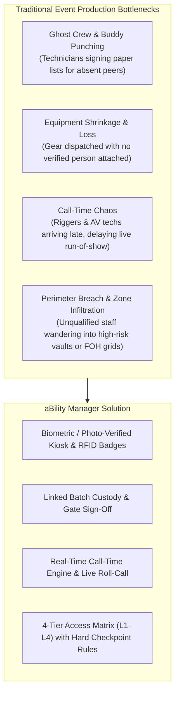
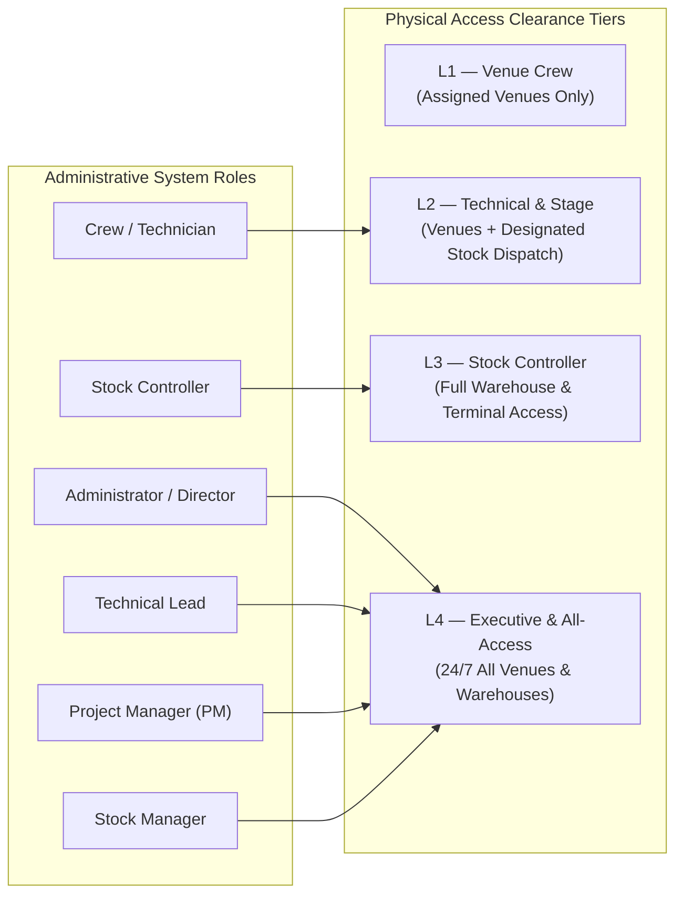
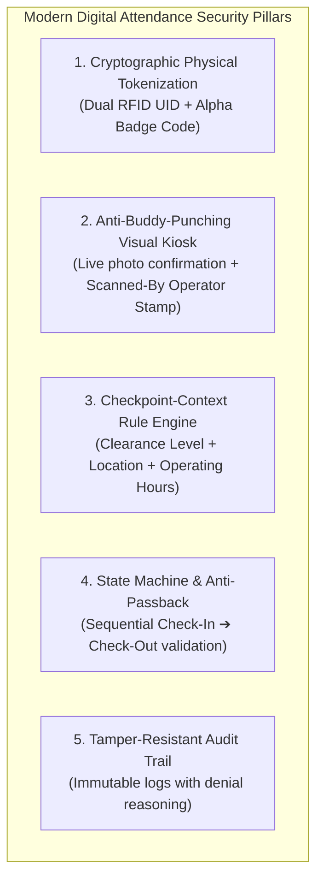

# aBility Attendance & Access Manager: Product Journey & System Architecture Plan

---

## Executive Summary

The **aBility Attendance & Access Manager** is a purpose-built, high-concurrency event operations and gate control system. It bridges the critical divide between **physical workforce punctuality**, **access security**, and **high-value equipment logistics** across dynamic event environments (live concert arenas, international summits, production warehouses, and broadcast stages).

---

## 1. What Are We Trying to Solve? (The Problem Statement)

Event production and live entertainment operations suffer from distinct structural vulnerabilities that generic HR attendance tools (e.g., standard clock-in mobile apps or static biometric thumb scanners) fail to address:

### The Core Challenges Addressed:

1. **Unsynchronized Multi-Site Operations:**
   - Crews simultaneously operate between central warehouses (e.g., *Ndera Logistics Hub*), staging vaults (*BK Arena Stock*), and dynamic client venues (*Kigali Convention Centre*).
   - Operations managers traditionally have zero unified real-time visibility into who is at the warehouse packing trusses versus who has arrived on-site for stage setup.

2. **The "Call Time" Imperative in Live Events:**
   - Unlike standard corporate 9-to-5 environments where a 10-minute delay is benign, event production runs on strict, interdependent **Call Times**.
   - If Riggers (Call Time 07:00) arrive late, Lighting Technicians (Call Time 08:30) cannot hang moving fixtures; Audio Technicians (Call Time 10:00) cannot fly line arrays; soundcheck is delayed, and rehearsals collapse.
   - The app solves this by binding attendance evaluation directly to the **checkpoint-specific Call Time** with automated classification: `Early`, `On-Time`, and `Late`.

3. **Decoupled Equipment Custody:**
   - Million-dollar equipment (L-Acoustics arrays, DiGiCo digital consoles, Robe moving fixtures, LED broadcast processors) frequently moves between warehouses and venues with paper waybills that get lost or signed illegibly.
   - This app directly couples **personnel physical check-in** with **equipment batch custody** (`BATCH-...`), ensuring no gear leaves a warehouse or enters a venue without an authenticated technician and an approving stock controller logged.

4. **Security Clearance & Zone Segregation:**
   - Not every crew member should access every area. A stagehand or driver should never have unescorted access to high-value equipment vaults, nor should an unassigned technician wander into a secure diplomatic summit venue.

---

## 2. How Is This Useful to an Event Management Company?

| Operational Dimension | How the System Delivers Value | Business & Financial Impact |
| :--- | :--- | :--- |
| **Real-Time On-Site Roll-Call** | Instant dashboard metrics showing total crew on site, active check-ins, late arrivals, and absent assigned personnel per venue. | Eliminates manual roll-call clipboards, WhatsApp check-in spam, and uncoordinated radio calls. PMs know exact headcount before stage doors open. |
| **Automated Call-Time Punctuality** | Call times can be set or adjusted on the fly per venue or warehouse; every scan calculates punctuality down to the second. | Enforces professional discipline among freelance technicians; provides transparent data for contractor ratings and performance bonuses/penalties. |
| **Equipment Loss & Damage Mitigation** | Equipment batches are tied to technician badges upon gate entry/exit, requiring dual sign-off (Technician + Stock Controller). | Drastically cuts equipment shrinkage, lost cables, misplaced flight cases, and unreturned gear after late-night event strikes. |
| **Emergency Safety & Compliance** | Dedicated Roll-Call modal displays real-time on-site personnel with emergency contact numbers and blood groups (`blood_group`, `emergency_contact`). | In case of venue evacuation, fire, or stage safety incidents, the safety officer has an instant digital manifest of everyone inside the perimeter. |
| **Accurate Contractor Billing & Payroll** | Exact timestamped log of check-in, check-out, duration, and overtime hours. | Prevents overbilling from daily-rate technicians and external staging contractors. Protects against labor disputes. |
| **Rapid Turnaround & Strike Operations** | Supports rapid QR/Barcode camera scanning and RFID badge taps on tablets, laptops, or dedicated gate terminals. | Inbound and outbound load-in / load-out flows remain fast and frictionless without holding up delivery trucks. |

---

## 3. Tiers, Roles & Permissions: Action Delegation Matrix

To maintain security and prevent chaos, the system establishes a clear distinction between **Physical Clearance Levels (The 4-Tier Matrix)** and **Digital Administrative Roles (System Permissions)**.

### 3.1 The 4-Tier Physical Access Matrix (Gate Enforcement)

1. **Level 1 (L1) — Event Venue Crew (Green):**
   - **Target Audience:** General venue staff, runners, drivers, perimeter security.
   - **Venue Access:** `Assigned Venues Only` during event dates.
   - **Stock Warehouse Access:** `NO / BLOCKED`. If an L1 badge scans at a warehouse gate, the terminal sounds a red denial alarm (*"Level 1 is not authorized for Stock Warehouses"*).
2. **Level 2 (L2) — Technical & Stage (Blue):**
   - **Target Audience:** Audio, lighting, video, rigging, and stage technicians.
   - **Venue Access:** `YES` (Access to Backstage, FOH, Control Booth, Stage).
   - **Stock Warehouse Access:** `YES (Dispatch Only)`. Allowed entry into warehouse loading bays solely when receiving or returning an approved equipment batch.
3. **Level 3 (L3) — Stock & Logistics Controller (Amber):**
   - **Target Audience:** Warehouse supervisors, inventory controllers, logistics dispatchers.
   - **Stock Warehouse Access:** `FULL 24/7 Access` to all warehouses, loading bays, and staging vaults.
   - **Venue Access:** `YES` (Assigned logistics zones).
4. **Level 4 (L4) — Executive & All-Access (Red):**
   - **Target Audience:** Managing Directors, Technical Leads, Production Managers, Chief Safety Officers.
   - **Access:** Unrestricted 24/7 access to all physical checkpoints, production vaults, backstage areas, and master gates.

---

### 3.2 Digital Role Delegation: Answering Specific Operational Queries

#### Q1: Can a Stock Manager or Stock Controller add users to the system?
- **Current Architecture vs. Recommended Policy:**
  - **Stock Controller (Warehouse Operator on the floor):**
    - **NO.** A Stock Controller must be locked down strictly to the **Gate Terminal & ID Badge Kiosk (`#pane-kiosk`)** and **Batch Custody Manifests**. They should *never* have permission to create arbitrary users, alter security clearance tiers, or delete logs. This prevents warehouse-floor distractions, collusion, and unauthorized privilege inflation.
  - **Stock Manager (Logistics Head / Warehouse Lead):**
    - **YES, with Restricted Scope.** A Stock Manager should have scoped user provisioning rights: they can onboard temporary logistics drivers, forklift operators, and warehouse day-laborers with **L1 or L2 clearance only**. They must **NOT** be able to create L3/L4 accounts or grant all-access passes.
  - **Administrator / HR Operations:**
    - Full user creation, role assignment, clearance level assignment, and badge deactivation rights.

#### Q2: Can a Technical Lead assign users to events & set call time?
- **YES. This is an essential operational duty for a Tech Lead:**
  - **Setting & Adjusting Call Time:**
    - Technical Leads are directly responsible for load-in schedules. If the stage build requires rigging inspections 2 hours earlier, the Tech Lead must have the authority to update the venue's call time (e.g., from `08:00` to `06:30`) via the Call Time Modal.
    - When call time is updated, the app recalculates punctuality for all subsequent scans against the new target.
  - **Assigning Crew to Events & Stages:**
    - The Tech Lead determines which sound engineers, lighting techs, and video operators are deployed to which event.
    - In the system, the Tech Lead can assign technician IDs to specific events (`events.assigned_technician`) and assign custody of equipment batches to specific technicians (`stock_movements.technician_id`).

---

### 3.3 Comprehensive Role-Based Access Control (RBAC) Governance Matrix

| Action / Capability | Administrator / Director | Production PM | Technical Lead | Stock Manager | Stock Controller | Crew / Technician |
| :--- | :---: | :---: | :---: | :---: | :---: | :---: |
| **Add / Edit Users & Profiles** | Full | Scoped (Crew) | Scoped (Dept) | Scoped (Warehouse) | No Access | Read-Only Self |
| **Assign Clearance Tier (L1–L4)** | Full (L1–L4) | L1–L2 Only | L1–L2 Only | L1–L2 Only | No Access | No Access |
| **Issue / Replace RFID Badges** | Yes | Yes | Yes | Yes (Logistics) | Scan-Only | No Access |
| **Set & Update Call Times** | Yes | Yes | **Yes** | Yes (Whse Open) | No Access | No Access |
| **Assign Technicians to Events** | Yes | Yes | **Yes** | No Access | No Access | No Access |
| **Create & Dispatch Stock Batches**| Yes | Yes | Yes | Yes | **Yes (Verify/Sign)**| Read / Accept |
| **Approve / Release Equipment** | Yes | Yes | Yes | Yes | **Yes (Approve)** | No Access |
| **Operate Gate Scanner Kiosk** | Yes | Yes | Yes | Yes | **Yes (Primary)** | No Access |
| **View Live Roll-Call & Logs** | Full System | Assigned Venues| Assigned Dept | Warehouse Logs | Terminal Only | Self-History |
| **Edit System Settings / Delete Data**| Full | No Access | No Access | No Access | No Access | No Access |

---

## 4. Digital Attendance Vision & Security Alignment

To align with modern digital enterprise standards and ISO-grade security, the system departs from legacy "paper clipboards" and vulnerable "honor-system mobile check-ins":

### 1. Dual Physical Tokenization & Visual Verification:
- Every crew member is issued a credential combining a physical RFID/NFC serial UID (`rfid_uid`) and an internal badge code (`REW-BADGE-XXXX`).
- When presented to the gate kiosk, the system does not simply register a blind increment: it immediately surfaces the technician's official photo, emergency contact, role, and clearance badge on the monitor. The gate officer or stock controller performs a fast 1-second visual confirmation, completely eliminating **buddy-punching** (passing cards to friends).

### 2. Context-Aware Checkpoint Rule Engine:
- Access is never evaluated globally; it is strictly evaluated **in context**:
  - *What is the checkpoint type?* (`stock_warehouse` vs `event_venue`).
  - *Is the user's tier allowed at this checkpoint?* (e.g., L1 attempting warehouse entry = automatic denial).
  - *Is the badge active?* (Suspended or expired badges are rejected immediately).
  - *Is the checkpoint currently open?* (Checking warehouse operating hours `open_time` to `close_time`).

### 3. Paired State Machine & Anti-Passback:
- The system tracks the staff member's live daily state (`checked_in` vs `checked_out`).
- If a technician is already checked in at *Kigali Convention Centre*, they cannot simultaneously check in at *BK Arena* without checking out first, preventing ghost attendance or fraudulent double-scanning across physical locations.

### 4. Immutable Auditability & Denial Telemetry:
- Denied scans are just as valuable as granted scans.
- When an unauthorized access occurs, the system records:
  - Exact timestamp down to the second.
  - The badge code and user ID.
  - The gate checkpoint ID and name.
  - The ID of the operator running the terminal (`scanned_by`).
  - The exact algorithmic denial reason (e.g., *"Level 1 (Venue Crew) is not authorized for Stock Warehouses"*).
- This creates an incontrovertible digital evidence log for security debriefs and incident reviews.

---

## 5. Strategic Roadmap & Recommended Codebase Enhancements

To take the existing attendance app from its current state to an enterprise-grade SaaS production deployment, the following progressive enhancements are recommended:

1. **Milestone 1 — Granular Backend Permission Guards (`api.php`):**
   - Enforce server-side session checks on `save_user`, `update_call_time`, `save_clearance_tier`, and `save_batch` using the RBAC matrix defined in Section 3.3.
   - Ensure a Stock Controller cannot execute `save_user` or `save_clearance_tier` even via direct API manipulation.

2. **Milestone 2 — Tech Lead Event Crew Assignment Interface:**
   - Enhance the Events management view to allow Tech Leads to drag-and-drop or multi-select technicians directly into an event roster.
   - Link the event roster directly to the Gate Kiosk so that selecting a venue filters the quick roll-call directly for that event.

3. **Milestone 3 — Offline-First PWA Sync for Gate Terminals:**
   - Event loading docks and basement arenas often have intermittent Wi-Fi or cellular dead zones.
   - Utilize a service worker and IndexedDB queue so gate scans continue instantaneously offline and automatically sync back to `api.php?action=process_gate_scan` when connectivity restores.

4. **Milestone 4 — WhatsApp / SMS Automated Call-Time Alerts:**
   - Send automatic reminders 90 minutes before call time: *"Eric, your call time for World Bank Summit Rigging is 07:00 AM at KCC. Please have your badge ready for gate check-in."*
   - Trigger automated notifications to the Tech Lead if a critical crew member has not checked in 15 minutes past call time.
